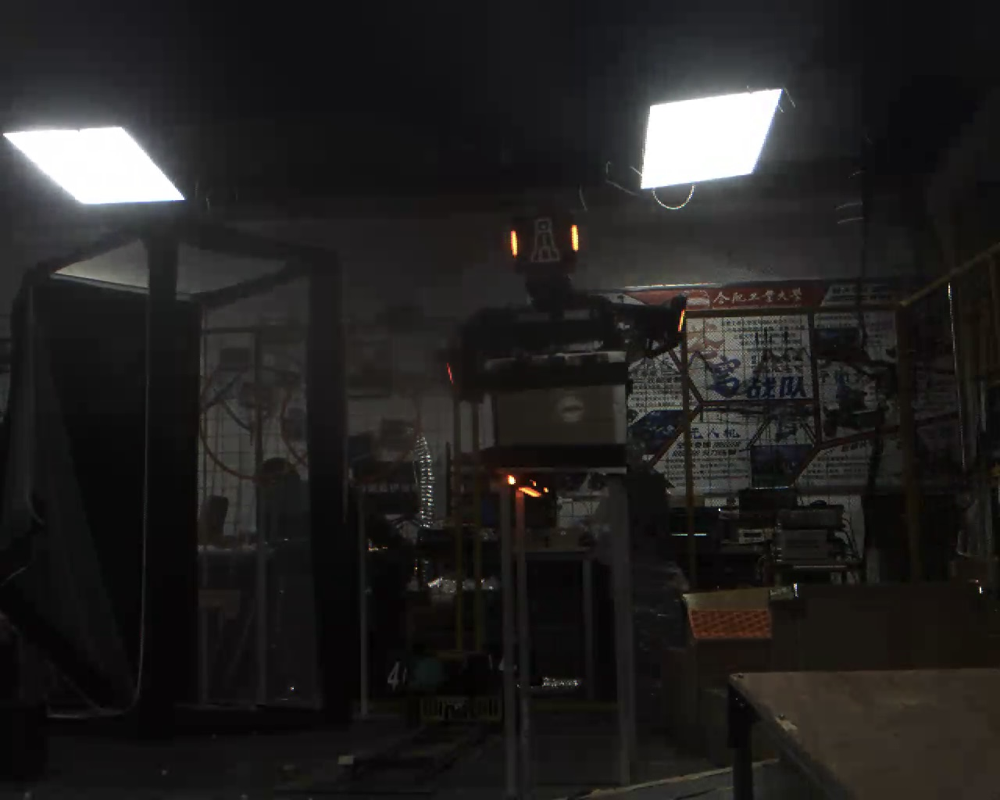

# 传统视觉装甲板识别任务

## 一、本阶段要完成什么

本阶段开始进入“装甲板识别与预测”综合项目，但这两周只完成其中的**静态图片装甲板检测**部分。

你需要编写一个 C++/OpenCV 程序：输入一张指定的前哨站图片，程序自动从图片中找出可见的装甲板，并输出检测结果。程序应自己完成颜色分割、灯条候选提取、灯条配对和装甲板结果绘制。

检测过程不能依靠手动画框，也不能把这张图片中目标的坐标直接写死在代码里；换成另一张图片时，程序仍应按照同一套流程返回检测结果。

后续阶段会把本阶段的“输入一张图，返回检测结果”模块逐帧接入视频，所以本阶段要把单帧输入和输出接口整理清楚。

## 二、指定输入图片

任务目录中的 `images/outpost_frame.png` 是从前哨站视频中抽取的一帧，保留原始分辨率，尺寸为 **1280 × 1024**，包含 3 个颜色通道。它只是本阶段的静态输入，程序运行时不需要打开原始 AVI 视频。



图片中可见的发光灯条是本阶段要处理的目标线索。你要根据灯条的颜色、形状和相互位置，找出属于同一块装甲板的两根灯条，并输出装甲板候选。图片较暗，背景中也有其他结构和光源，因此不能只用“整张图中最亮的区域”作为最终答案。

## 三、程序输入和输出

### 1. 输入

- 输入文件：`images/outpost_frame.png`；
- 先将任务目录中的这张图片复制到自己项目的 `images/` 文件夹中，并保持文件名为 `outpost_frame.png`；提交项目时一并提交这张图片；
- 使用项目内相对路径读取，不要在代码中写入个人电脑的绝对路径；
- 建议让程序支持从命令行传入图片路径，例如：

```text
程序名 images/outpost_frame.png
```

如果暂时没有实现命令行参数，也至少要把输入路径集中放在一个容易修改的位置，不能把同一个路径散落在多个函数中。

### 2. 必须保存的中间结果

将结果保存到项目内的 `output/` 文件夹。文件名可以自行设计，但至少要有以下几类：

如果项目中还没有 `output/` 文件夹，请先创建它，或让程序在保存前自动创建；保存图片后检查 `imwrite` 是否成功。

| 结果 | 要说明什么 |
| --- | --- |
| 实际目标颜色 mask | 哪些像素被程序认为可能属于目标颜色 |
| 蓝色 mask（如果程序保留蓝色检测） | 哪些像素被程序认为可能属于另一种目标颜色 |
| 灯条候选图 | 颜色分割和轮廓筛选后保留了哪些疑似灯条 |
| 最终装甲板结果图 | 哪些灯条被配成了装甲板，框、中心点和四角点在哪里 |

mask 中应使用白色表示保留的目标像素、黑色表示排除的像素，便于检查后续轮廓提取是否使用了正确的前景。

### 3. 必须输出的最终信息

对每个装甲板候选，在终端或结构化文本文件中输出至少以下信息：

- 颜色；
- 装甲板外接框；
- 装甲板中心点；
- 四个角点坐标；
- 当前结果是否有效。


## 四、需要完成的具体任务

### 1. 建立并检查项目

- 沿用前面已经能够编译运行的 CMake/OpenCV 项目；
- 程序启动时检查图片是否成功读取，并输出图片宽度、高度和通道数；
- 图片读取失败、结果保存失败等情况要给出提示并正常结束，不要继续对空图像调用 OpenCV 函数；

建议先定义能表达检测结果的数据结构。例如，灯条候选需要保存颜色、旋转矩形、中心点和方向；装甲板候选需要保存颜色、外接框、中心点、四角点和有效状态。

### 2. 观察图片并制定分割思路

在写筛选条件之前，先观察指定图片：目标灯条大致位于哪里、颜色是什么、背景中有哪些相似颜色或亮点。然后选择一种或组合使用以下方法生成 mask：

- BGR 通道差异；
- HSV 颜色范围和 `inRange`；
- 灰度亮度阈值与颜色条件结合。

本阶段不要求固定使用某一种方法，但必须能解释为什么选择它。红色在 HSV 中可能跨越色相范围的边界，需要注意是否要用两段范围生成 mask 后再合并；蓝色则应根据实际图片观察范围，不要直接照抄其他图片的参数。如果指定图片中只出现一种目标颜色，不需要为了凑齐两种颜色而强行生成另一张有效 mask。

可以使用适度的滤波和形态学操作清理噪声，但每次调整后都要查看 mask：

- 目标灯条是否仍然是白色；
- 灯条是否被滤波得过细或消失；
- 两根灯条是否被形态学操作粘成一片；
- 背景是否出现大面积白色区域。

如果 mask 中没有目标，应先检查颜色范围、阈值方向和输入图像；不要直接从最后的配对条件开始改。

### 3. 从 mask 中提取灯条候选

- 对适合的单通道 mask 调用 `findContours`；
- 对每个轮廓计算面积；
- 使用 `boundingRect` 或 `minAreaRect` 观察轮廓的大小、长宽比、中心点和方向；
- 逐步加入面积、细长度、尺寸和倾斜角等条件，排除明显噪声和背景结构；
- 保留每个候选的颜色信息，后面配对时不能丢掉颜色类别；
- 在输入图副本上绘制候选轮廓或旋转矩形、中心点和编号，并保存候选图。

筛选条件要集中放置，方便调整。不要只留下“看起来最好”的一个灯条；本阶段要得到候选集合，再由下一步的配对关系判断哪些候选可能组成装甲板。

### 4. 配对灯条并筛选装甲板候选

从灯条候选中尝试组成左右组合。至少检查以下几何关系：

- 两根灯条颜色是否一致；
- 灯条长度是否大致相近；
- 灯条方向是否协调；
- 两根灯条中心的上下偏差是否合理；
- 两根灯条之间的水平间距是否合理；
- 间距与灯条长度的比例是否像一块装甲板，而不是两个无关的亮点。

这些条件应使用中心点距离、长度比例、角度差等可计算的量表达。尽量使用相对比例，不要只依赖某个固定像素距离，否则目标大小变化时容易失效。

对通过配对的组合继续做一次整体比例检查，并处理同一块装甲板被重复输出的情况。每个组合要保存对应的左右灯条编号，便于在结果图中检查配对是否正确。

### 5. 生成框、中心点和有序四角点

对每个装甲板候选输出：

- 能覆盖装甲板候选的外接框；
- 两根灯条中心或四个角点的平均位置得到的中心点；
- 由左右灯条旋转矩形顶点得到的四个角点。

四角点必须固定顺序。建议统一为：

```text
左上 → 右上 → 右下 → 左下
```

这里的“左、右、上、下”是相对于当前图片的图像坐标方向。若目标发生倾斜，也要通过排序或几何关系保持同一顺序，不能让程序在不同情况下随机交换点。结果图上给四个角点标出 `0、1、2、3`，用来检查顺序。

四角点顺序是后续 `solvePnP` 的输入约定。本阶段即使还不做三维位姿，也要把这个接口做好，否则下一阶段会出现距离和朝向异常。

### 6. 完善单帧检测接口

将完整流程整理成一个可以重复调用的单帧函数：

```text
输入：一张彩色图像
输出：装甲板候选列表，以及必要的调试 mask
```

这个函数不能依赖全局保存的某一张图片，也不能把指定图片中某个目标的坐标直接写在函数里。输入换成一张尺寸相同但内容不同的图片时，即使结果不完美，也应按照同样的流程返回零个、一个或多个候选。

## 五、测试与问题记录

本阶段的主验收图片是 `images/outpost_frame.png`。

至少完成下面两项异常测试：

1. 临时将输入文件名改成不存在的路径，确认程序能提示读取失败并结束；测试后恢复正确路径。
2. 临时把颜色范围或面积阈值改到明显检测不到目标，确认程序能输出零个候选而不是崩溃；测试后恢复正常参数。

如果条件允许，可以从原始视频中再抽取 2–3 张不同时间的图片，仅用于自测，不作为本阶段统一验收输入。自测图片可以帮助发现参数是否严重依赖指定帧，但不要求在本阶段解决视频连续帧、目标跟踪或所有角度下都正确。

记录至少两类实际遇到的问题，例如：

- mask 中背景亮点过多；
- 真实灯条被面积或长宽比条件过滤掉；
- 两根无关灯条被错误配对；
- 同一块装甲板重复输出；
- 四角点顺序在倾斜情况下发生变化。

每类问题写清楚：它出现在哪一步、你修改了什么、修改后结果如何、是否带来了新的误检或漏检。不要只提交一张最好看的结果图。

## 六、阶段验收标准

完成本阶段至少应满足以下条件：

- 能用 CMake 编译并运行；
- 能从项目内相对路径读取指定图片，并检查读取失败；
- 程序自动生成颜色 mask、灯条候选图和最终结果图；
- 不手动画框、不把目标坐标写死，检测过程由图像内容和几何条件完成；
- 指定图片中至少一块清晰可见的装甲板能够被自动输出为候选；
- 每个有效候选有颜色、外接框、中心点和四个角点；
- 四角点顺序在代码和说明中有明确约定，并在结果图中标注编号；
- 没有候选时程序能正常返回并给出明确提示；
- 至少保留一张 mask、一张灯条候选图和一张最终标注图；
- 有简短问题记录和运行说明，别人可以按照说明重新运行。

本阶段不以“把整张图片中所有可能目标都百分之百找对”为唯一标准。更重要的是：你能把输入、分割、轮廓、候选筛选、配对和输出连成一条可解释、可调试的流程，并为下一阶段逐帧处理视频留下稳定接口。

## 七、提交内容

- 源代码；
- 红色或目标颜色 mask、蓝色 mask（如有）、灯条候选图和最终结果图；
- 终端输出和运行截图；
- 问题记录，至少包含两类问题及修改过程；
- 一段简短说明，解释你使用的颜色分割方式、灯条筛选条件、配对依据和四角点顺序。
- 更新后的完整 CMake 工程和运行说明，确保别人可以按照说明重新编译运行。


