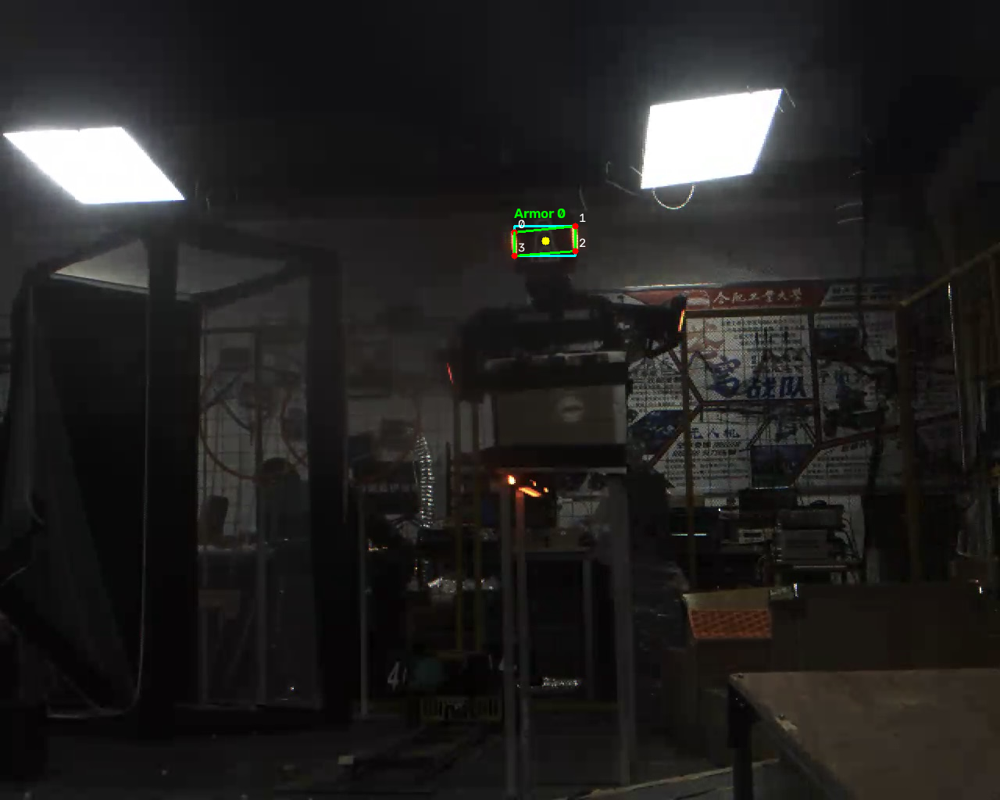

# 静态图片装甲板识别

本任务使用 C++ 和 OpenCV，对 `images/outpost_frame.png` 进行处理，通过灯条的颜色、形状和相互位置识别装甲板。

**实现流程**

1. 读取图片并检查是否成功，输出图片尺寸和通道数。
2. 将图片转换为 HSV，分别提取包含橙红的低色相区间和高色相红色区间，再合并为红色 mask。
3. 对 mask 先做闭运算，再做开运算，连接局部断裂区域并清理小噪声。
4. 提取轮廓，通过面积、长度、长宽比和倾斜角筛选灯条候选。
5. 将同色灯条两两组合，检查长度比例、角度差、上下偏差和间距。对通过检查的组合按评分从低到高选择，避免重复使用同一根灯条。
6. 根据左右灯条的长轴端点生成四角点，顺序固定为左上、右上、右下、左下，再计算中心点和外接框，绘制并保存结果。

检测流程封装在 `detectArmors` 中，参数集中在 `armor_detector.h` 的 `DetectionParams` 中，便于调整。

**遇到的问题与处理思路**

- 颜色分割范围如何选择。图片中的灯条包含偏橙黄的发光区域，因此低色相区间覆盖到橙黄色，同时合并高色相端的红色区间。代码保留了蓝色分割，供后续扩展使用。
- 多根灯条如何配对。先用几何条件排除明显不合理的组合，再综合长度差异、上下偏差、角度差和间距进行评分，优先保留评分较低的组合，并标记已经使用的灯条。

**运行结果**

指定图片中得到 3 根红色灯条候选，最终配成 1 块有效装甲板候选。终端输出颜色、外接框、中心点和四角点坐标。

`output/` 中保存原始红色 mask、清理后的红色 mask、蓝色 mask、灯条候选图和最终装甲板结果图。

当前结果基于指定单帧图片，其他场景下的效果还需要进一步测试。
